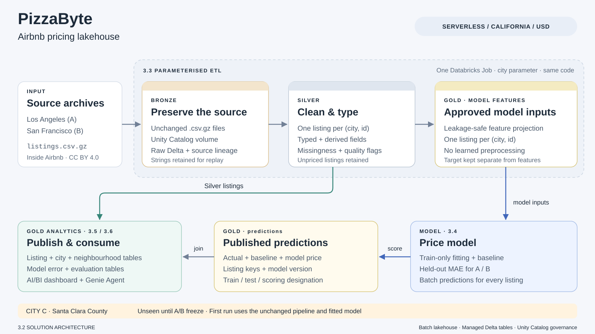

# 3.2 Solution architecture

[High-resolution PNG](solution_architecture.png)

## Short description

PizzaByte uses a batch medallion lakehouse on **Databricks Free Edition**. The
initial inputs are Los Angeles (A) and San Francisco (B), in USD; Santa Clara
County (C) stays unseen until the A/B pipeline and model are frozen. The
[exploratory analysis](../notebooks/exploratory_analysis.ipynb) supplies the
cleaning decisions and leakage exclusions.

**Bronze preserves the source.** The selected city's unchanged
`listings_<city>.csv.gz` is staged in a Unity Catalog volume. Spark reads it with
a header, multiline records and escaped quotes into a raw Delta table. Source
fields remain strings, with `city`, source-file and ingestion metadata added
for replay and audit.

**Silver provides cleaned, typed listings.** A column whitelist and null/type
conversions preserve integer IDs and retain `price_text` alongside numeric
`price`. Derived fields include bathrooms, amenities count, stay type and
quality flags. Unpriced, stale and extreme-price listings remain available for
scoring; duplicate or null keys are handled separately rather than silently
inflating downstream counts.

**Gold serves analysis and modelling.** The ETL publishes an approved model-
feature projection. The price model (3.4) reads cleaned listings or this
projection and publishes baseline/model predictions. A separate gold-publication
step (3.5/3.6) combines silver listings with those predictions to produce the
analytical gold tables consumed by the dashboard and Genie. Each output has
one writer; the ETL does not duplicate the analytical summaries.

## Proposed storage and table contract

The reference namespace is **`workspace.airbnb`**, matching the dashboard/Genie
draft's input contract. Bronze, silver and gold are logical layers identified
by object prefixes within this schema; separate schemas are not required.
Physical names can be parameters without changing the architecture. These are
design interfaces, not a claim that the objects are already deployed.

| Layer / object | Grain and purpose | Writer |
|---|---|---|
| `/Volumes/workspace/airbnb/raw/` | Original selected-city archives | ETL, 3.3 |
| `workspace.airbnb.bronze_listings` | Raw source records, original strings and lineage | ETL, 3.3 |
| `workspace.airbnb.silver_listings` | One typed listing per `(city, id)` for the selected snapshot, including `price_valid`, `stay_type` and `is_stale` | ETL, 3.3 |
| `workspace.airbnb.gold_model_features` | Approved unencoded listing features, target and separate eligibility metadata; no learned imputation or encoding | ETL, 3.3 |
| `workspace.airbnb.gold_predictions` | Listing keys, `split`, `predicted_price`, `baseline_price`; optional `model_run` identifies versions | Model, 3.4 |
| `workspace.airbnb.gold_listings` | Listing-level analytical data | Gold publication, 3.5/3.6 |
| `workspace.airbnb.gold_city_summary` | City-level summaries | Gold publication, 3.5/3.6 |
| `workspace.airbnb.gold_neighbourhood_stats` | City/neighbourhood summaries | Gold publication, 3.5/3.6 |
| `workspace.airbnb.gold_model_errors` | Listing-level prediction errors for the selected run | Gold publication, 3.5/3.6 |
| `workspace.airbnb.gold_model_metrics` | Model/baseline evaluation summaries | Gold publication, 3.5/3.6 |

Managed Delta tables preserve `id`, existing feature names, per-row
`last_scraped` and source-file lineage. The LA archive contains several scrape
dates within one run. Refreshes replace only the selected city's current
snapshot, preserving other cities and avoiding duplicate listings.

Silver preserves the EDA's column names and derived fields. The model input
interface is independent of the analytical gold tables, allowing modelling and
dashboard work to proceed without a circular dependency. The EDA namespace,
`workspace.airbnb_eda`, remains separate from the operational pipeline.

Listing-level gold supports exact aggregation; subgroup medians and distinct-
host counts are not additive. Price summaries distinguish short and monthly
stays and use valid observed prices. The target remains **per-night USD price**.

## One pipeline, with explicit model boundaries

The ETL is designed as **one serverless Databricks Job with a `city` parameter**:
archive staging, bronze ingestion, silver transformation, then model-feature
projection and validation. `Los_Angeles` and `San_Francisco` use the same code.
Explicit filename selection prevents an A/B run from accidentally loading C.
The analytical gold publication follows available model predictions; it reads
all cities present in silver, so a permitted C run needs no copied code.

The pipeline checks parsing, row counts, key uniqueness, required types and
quality-flag counts. Absent optional columns become typed nulls; missing identity
fields or unreadable input fail visibly. The saved EDA's 43,781 LA and 7,405 SF
rows are checks for the supplied archives, not fixed expectations for C.

Model preprocessing is fitted on **A/B training rows only**, after the held-out
split. Predictors exclude `price_quote_*`, `estimated_revenue_l365d`,
`price_per_guest` and price-derived classes; target and eligibility flags are
metadata, not features. Review/availability fields are retained for analytics
but excluded from the main model allowlist. EDA-wide diagnostic fences are not
used as model preprocessing or test-set filters; fixed placeholder rules remain
separate from learned statistics.

Predictions contain `city`, `id`, `split`, `predicted_price` and `baseline_price`.
They join to silver by `(city, id)` within a selected model run. Run labels or
separately preserved outputs distinguish the original and revised models;
versions are not pooled in the same join or MAE. Reported A/B MAE uses held-out
test listings with valid targets, not all scored listings; C is evaluated
separately. Model fitting and prediction publication belong to 3.4.

City C enters only after the A/B code and fitted model are frozen. Its first
run uses `city=Santa_Clara_County` without pipeline or model changes; first-run
results are preserved separately from subsequent fixes in 3.7.

## Execution platform

The design uses Databricks Free Edition serverless compute, Unity Catalog
volumes and managed Delta tables. Gold consumers share catalog access governed
by Unity Catalog privileges. Gold table/column comments and Genie instructions
record business meaning. Section 3.2 specifies logical responsibilities and
interfaces; executable details and Databricks validation are recorded with the
pipeline, model, dashboard and Genie deliverables.

Platform references: [files versus volumes](https://docs.databricks.com/aws/en/files/files-recommendations),
[Unity Catalog objects and access](https://docs.databricks.com/aws/en/data-governance/unity-catalog/securable-objects),
and [Free Edition limits](https://docs.databricks.com/aws/en/getting-started/free-edition-limitations).
